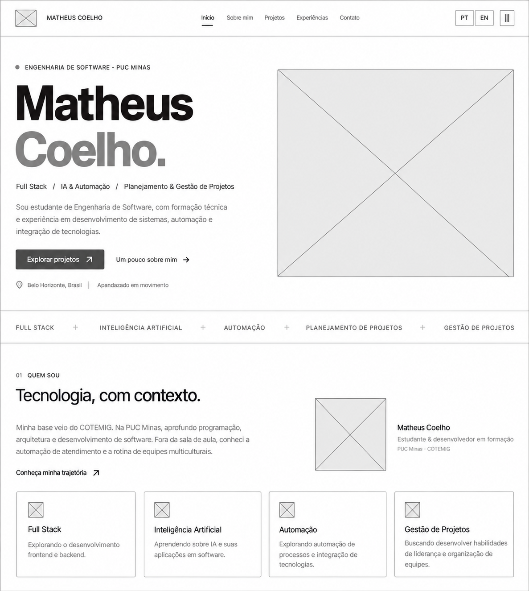
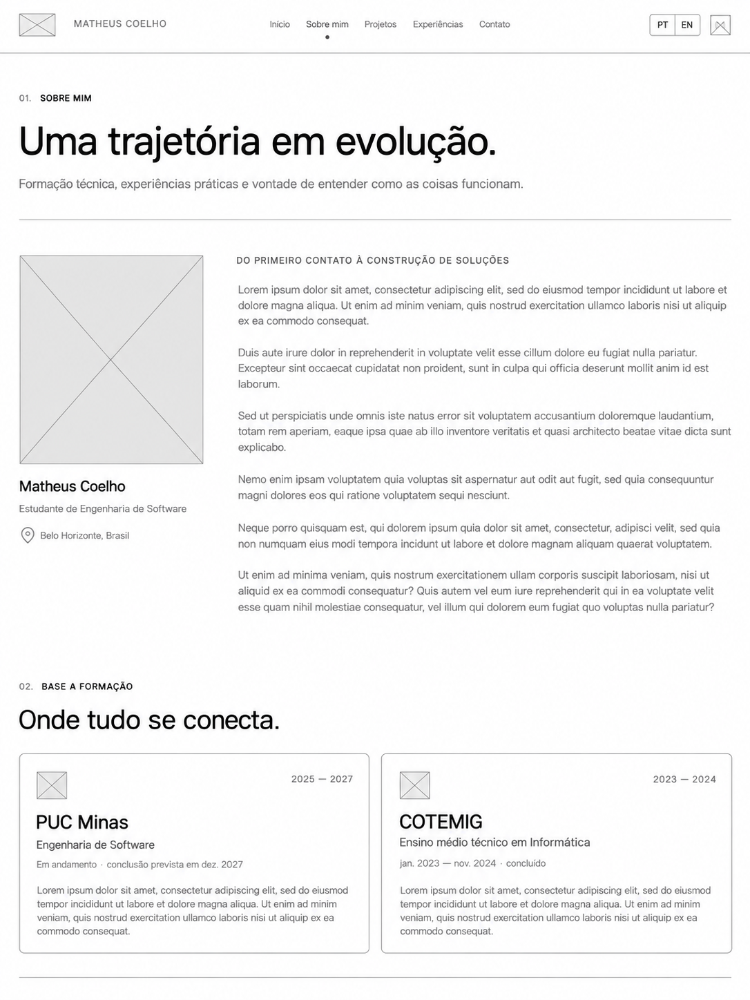
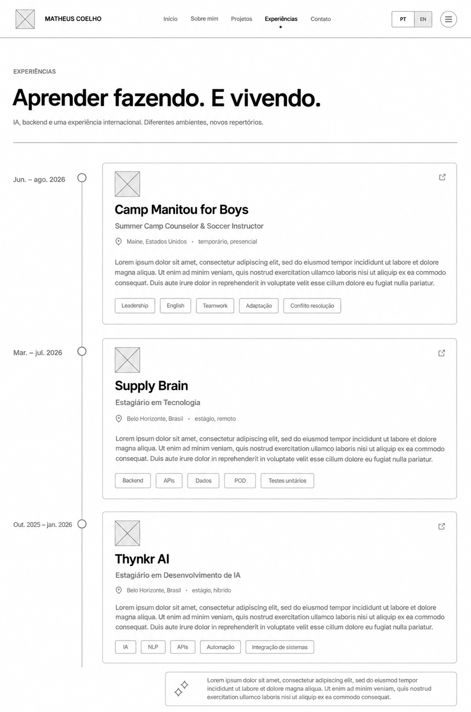
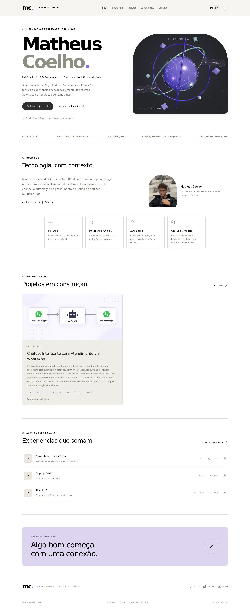
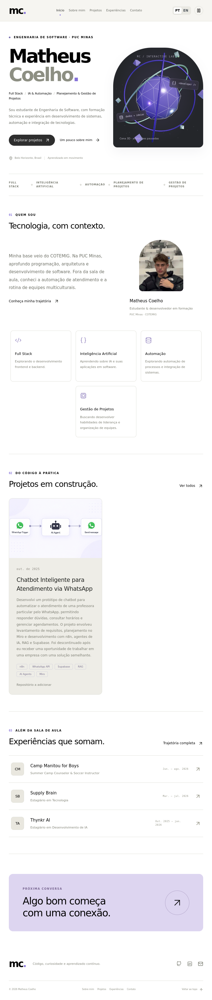
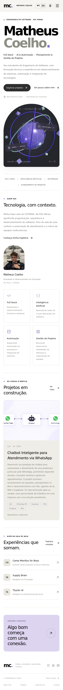

# Portfólio — Matheus Coelho


Portfólio desenvolvido para o Laboratório 01 de Desenvolvimento e Integração de Aplicações Web, do curso de Engenharia de Software da PUC Minas. Reúne minha formação, projetos, experiências profissionais e contatos.

## Links

- [Site publicado](https://meu-portfolio-eight-neon.vercel.app/)
- [Repositório do portfólio](https://github.com/matheusnNicoli/Meu-portfolio)
- [Wireframes no Figma](https://www.figma.com/design/ebGutL4TKDFrBVKlZf8rde/?node-id=2-105)
- [GitHub](https://github.com/matheusnNicoli)
- [LinkedIn](https://www.linkedin.com/in/matheus-coelho-749590206/)

## Funcionalidades

- Navegação entre Início, Sobre mim, Projetos, Experiências e Contato.
- Apresentação e textos principais em português e inglês.
- Formação acadêmica, competências e certificados.
- Projetos em ordem cronológica, com descrição, tecnologias, imagens e suporte a links.
- Experiências com instituição, cargo, período e descrição.
- Contatos clicáveis e formulário integrado ao EmailJS.
- Layout responsivo, cena 3D e opção de pausar animações.

## Tecnologias e dependências

| Tecnologia | Uso |
| --- | --- |
| React e React DOM | Interface |
| JavaScript e CSS | Lógica e estilos |
| Vite | Execução local e build |
| Mantine Core e Hooks | Componentes e consultas de tela |
| Radix UI Accordion | Lista expansível de competências |
| Three.js e React Three Fiber | Cena 3D |
| Motion, GSAP e React Parallax Tilt | Animações e interações |
| Lucide React | Ícones |
| EmailJS Browser | Envio de mensagens |
| ESLint | Verificação do código |
| Vitest, jsdom e Testing Library | Testes automatizados |

As versões estão em `package.json` e `package-lock.json`.

## Arquitetura e estrutura

Aplicação React executada no navegador, com navegação por fragmentos de URL, como `#projetos`. Os dados são definidos em JavaScript. O envio do formulário utiliza o serviço externo EmailJS; não há servidor próprio ou banco de dados.

| Caminho | Conteúdo |
| --- | --- |
| `src/App.jsx` | Páginas, navegação e formulário |
| `src/content.js` | Informações pessoais e projetos |
| `src/App.css` e `src/index.css` | Estilos |
| `src/components/` | Cena 3D, animações e ícones |
| `src/utils.js` | Validação, tradução e ordenação |
| `public/` | Foto e imagens dos projetos |
| `docs/WIREFRAMES/` | Protótipos das páginas |
| `tests/` | Testes automatizados |

## Instalação e execução

Requer Node.js 24 ou superior e npm. Na pasta que contém `package.json`:

```bash
npm ci
npm run dev
```

Abra o endereço exibido no terminal. Para gerar e visualizar a versão de produção:

```bash
npm run build
npm run preview
```

## Formulário de contato

Copie `.env.example` para `.env.local` e preencha os dados da sua conta EmailJS:

```env
VITE_EMAILJS_SERVICE_ID=seu_service_id
VITE_EMAILJS_TEMPLATE_ID=seu_template_id
VITE_EMAILJS_PUBLIC_KEY=sua_public_key
```

Configure o destinatário no template. Use `{{from_name}}`, `{{from_email}}` e `{{message}}` no corpo e `{{reply_to}}` no campo de resposta. O e-mail do proprietário fica em `src/content.js`. Reinicie o servidor após alterar as variáveis.

Não coloque senhas ou chaves privadas em variáveis `VITE_*`, pois elas são incluídas no navegador. O recebimento deve ser conferido com um envio real.

## Publicação

Para hospedagem estática, utilize o comando `npm run build` e publique a pasta `dist`. Na Vercel, selecione o preset Vite e cadastre as três variáveis do EmailJS antes do build. Depois, preencha o endereço público na seção Links.

## Wireframes

| Início | Sobre mim |
| --- | --- |
|  |  |

| Projetos | Experiências |
| --- | --- |
|  |  |

## Responsividade

Capturas reais do site em desktop (1440 px), tablet (768 px) e celular (390 px).

| Desktop | Tablet | Celular |
| --- | --- | --- |
|  |  |  |

As capturas das cinco páginas em cada tamanho estão em [`docs/responsividade/`](docs/responsividade/).

## Verificações

```bash
npm test
npm run lint
npm run build
```

Os testes verificam navegação, apresentação em inglês, conteúdo de projetos, validação do formulário, envio simulado e ordenação por data. O envio simulado não comprova recebimento real de e-mail.

## Autor

**Matheus Coelho** — Engenharia de Software, PUC Minas.

## Referências

- Template de README e materiais da disciplina disponibilizados pelo professor João Paulo Aramuni.
- [React](https://react.dev/), [Vite](https://vite.dev/), [Mantine](https://mantine.dev/) e [EmailJS](https://www.emailjs.com/docs/).
- Desenvolvimento com auxílio de inteligência artificial.
